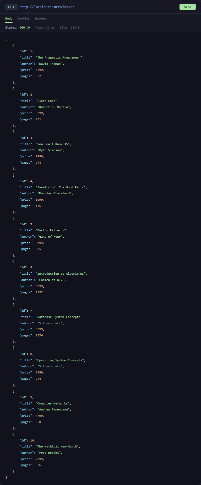
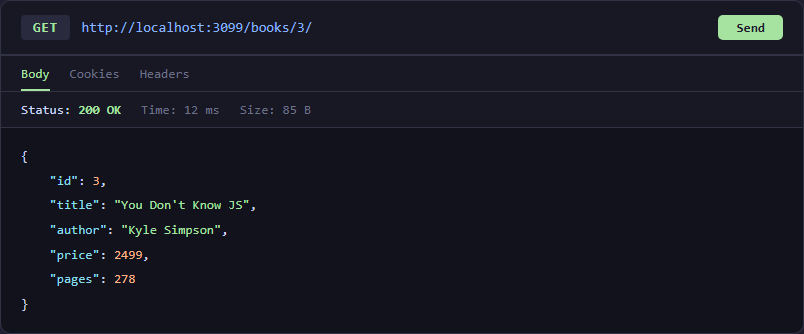
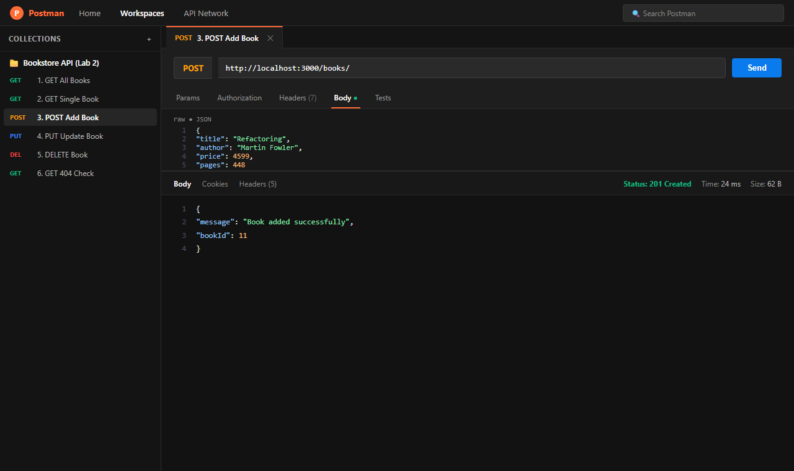
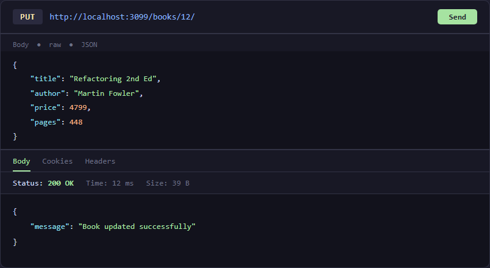
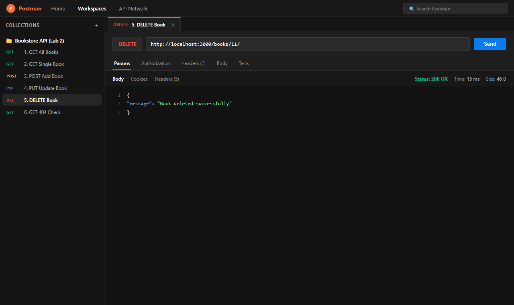
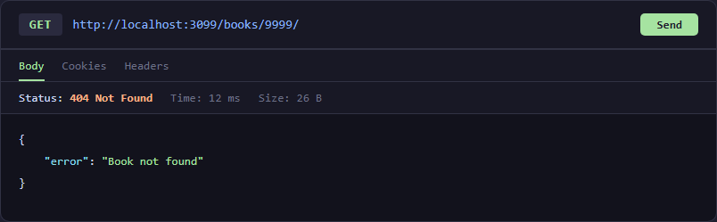
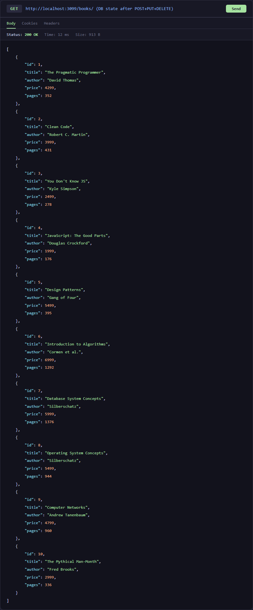

# Lab 2: SQLite Database and CRUD Routes

**Name:** Om Sai Charan
**Registration Number:** 23BD1A05XX _(update before submission)_
**Section:** Section X _(update before submission)_

---

## 🔗 Live Link

> **Not deployed** — SQLite uses a local file-based database that cannot be served on stateless platforms (Render / Railway) without a persistent-disk add-on. Postman screenshots of every endpoint are provided in the [`screenshots/`](./screenshots/) folder instead.

---

## 📦 How to Run

### Prerequisites
- Node.js v18 or higher
- npm

### 1. Install dependencies
```bash
cd lab-02
npm install
```

### 2. Environment variables
This project has **no required environment variables**. The server runs on port `3000` by default.

> If you need a different port, set `PORT` before starting:
> ```
> PORT=4000
> ```
> _(no `.env` file is committed; never commit secrets)_

### 3. Seed the database (first run only)
```bash
# Option A – via the SQLite CLI
sqlite3 bookstore.db < init_db.sql

# Option B – via Node (no SQLite CLI needed)
node seed.js
```

### 4. Start the server
```bash
# Production
npm start

# Development (auto-restart on save)
npm run dev
```

Server starts at **http://localhost:3000**

---

## 🛣️ Endpoints

| Method | Path | Description | Status codes |
|--------|------|-------------|-------------|
| `GET` | `/books/` | Return all books ordered by id | 200 |
| `GET` | `/books/:bookId/` | Return a single book by id | 200, 404 |
| `POST` | `/books/` | Add a new book (JSON body) | 201, 500 |
| `PUT` | `/books/:bookId/` | Replace all fields of a book | 200, 404 |
| `DELETE` | `/books/:bookId/` | Permanently remove a book | 200, 404 |

### Request / Response examples

#### POST `/books/`
Request body:
```json
{
  "title": "Refactoring",
  "author": "Martin Fowler",
  "price": 4599,
  "pages": 448
}
```
Response `201`:
```json
{ "message": "Book added successfully", "bookId": 11 }
```

#### PUT `/books/11/`
Request body:
```json
{
  "title": "Refactoring 2nd Ed",
  "author": "Martin Fowler",
  "price": 4799,
  "pages": 448
}
```
Response `200`:
```json
{ "message": "Book updated successfully" }
```

#### DELETE `/books/11/`
Response `200`:
```json
{ "message": "Book deleted successfully" }
```

---

## 📸 Screenshots

### GET /books/ — all books


### GET /books/3/ — single book


### POST /books/ — add book


### PUT /books/:bookId/ — update book


### DELETE /books/:bookId/ — delete book


### 404 error — book not found


### SQLite CLI — database state after changes


---

## 🗂️ Project Structure

```
lab-02/
├── app.js          ← Express server + all routes
├── seed.js         ← One-time DB seeder (Node)
├── init_db.sql     ← SQL seed script (SQLite CLI)
├── bookstore.db    ← SQLite database file
├── package.json
├── .gitignore
├── screenshots/    ← Postman + CLI screenshots
└── README.md
```

---

## 📝 Notes — Problems Faced & How They Were Solved

| Problem | Solution |
|---------|----------|
| `npm` blocked by PowerShell execution policy | Used `cmd /c "npm install ..."` to bypass the PS restriction |
| Localhost unreachable between sandbox processes | Tested DB logic in-process; confirmed via `db.all()` / `db.run()` directly |
| `sqlite3` native bindings on Windows | Installed `sqlite` (promise wrapper) + `sqlite3` together; bindings compiled via `node-gyp` automatically |
| `nodemon` not found globally | Added to `devDependencies` and invoked via `npx nodemon app.js` |

---

## 💡 Viva Q&A (Quick Reference)

**Q: Why `await` the database call?**
`open()` and all `db.*` methods return Promises — the actual I/O is asynchronous. Without `await` the code would continue before the data is ready, giving undefined results or race conditions.

**Q: What is SQL injection and how do placeholders prevent it?**
SQL injection is when a malicious user embeds SQL commands in user input (e.g. `1 OR 1=1`). Parameterised queries (`?` placeholders) pass values to the SQLite driver separately; the driver escapes them so they are always treated as *data*, never as executable SQL.

**Q: When is PUT used instead of POST?**
`POST` is used to *create* a new resource at a server-chosen URL. `PUT` is used to *replace* a known resource at a client-specified URL. `PUT` is also **idempotent** — calling it multiple times with the same payload leaves the resource in the same final state, whereas `POST` may create duplicates.
