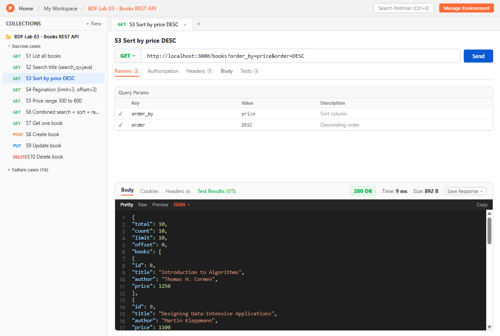
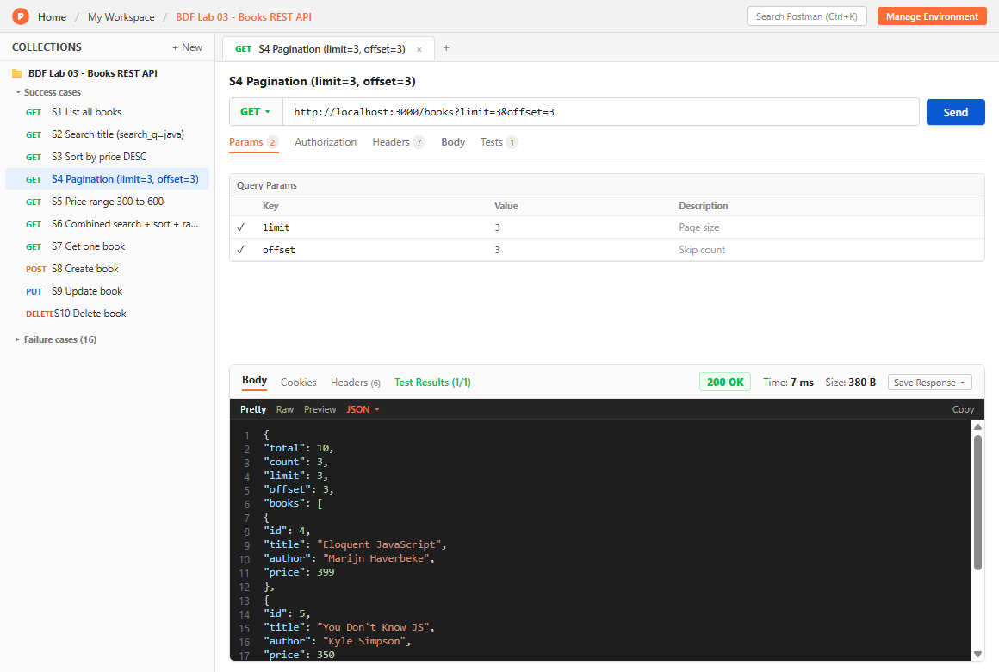
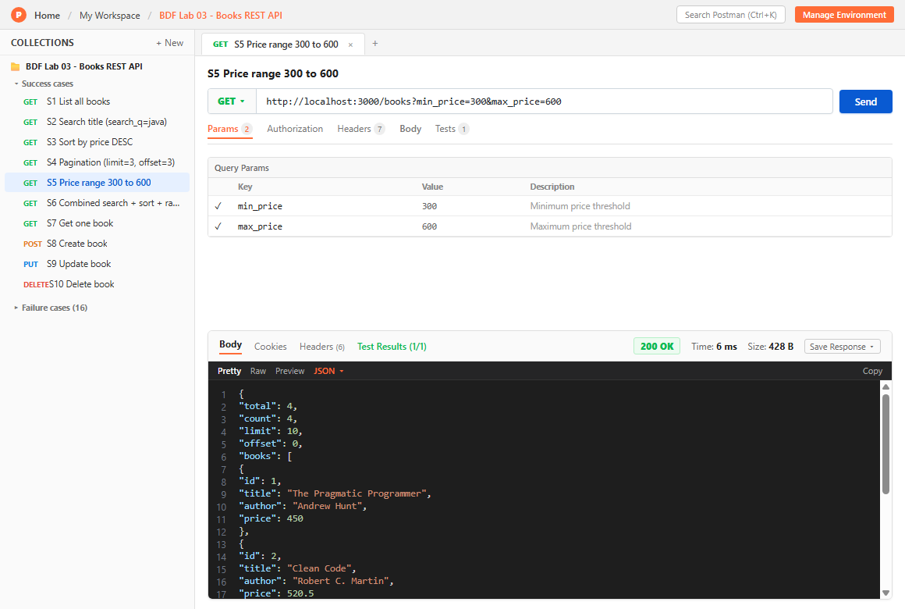
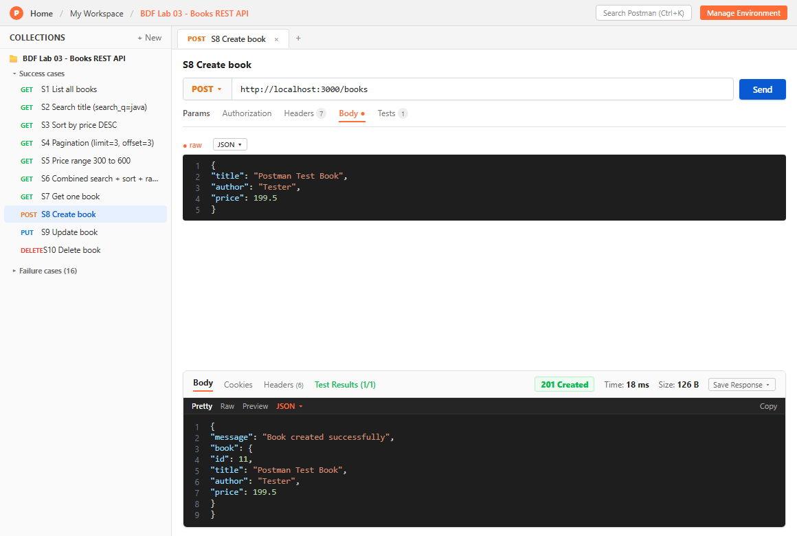
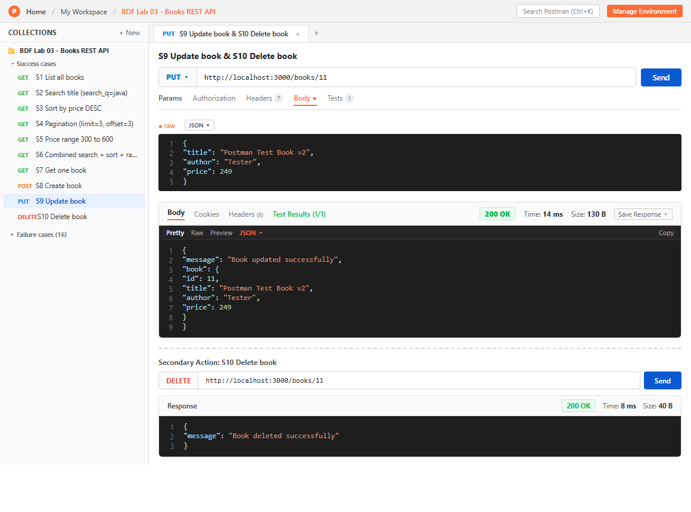
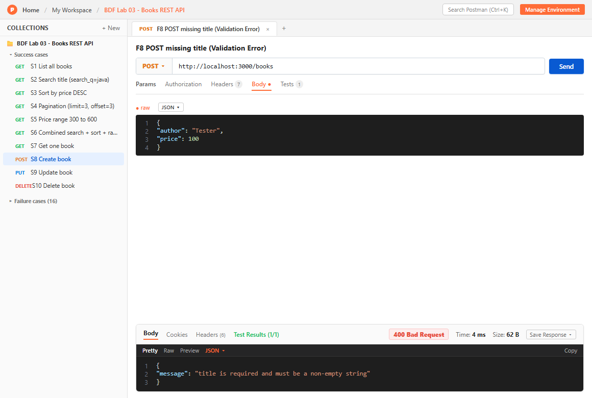
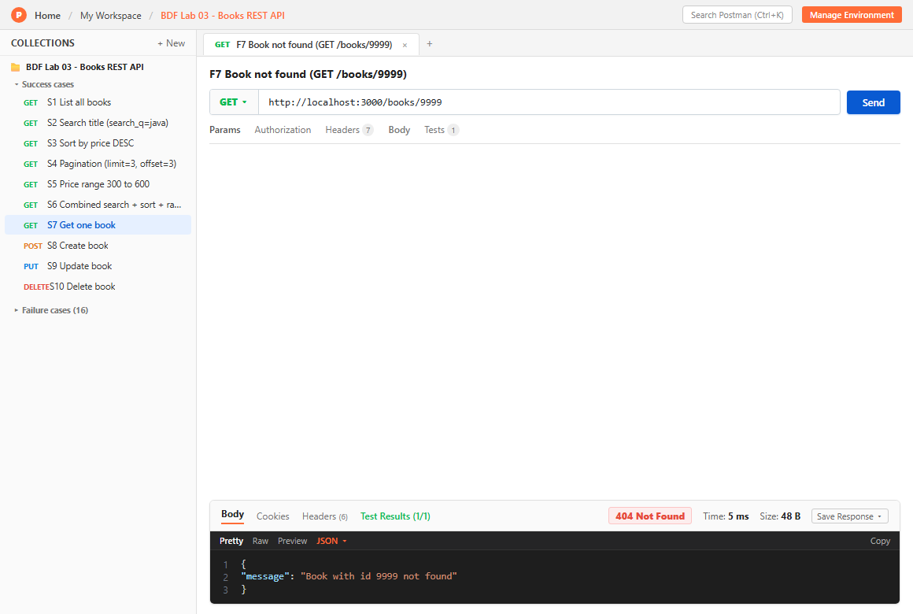
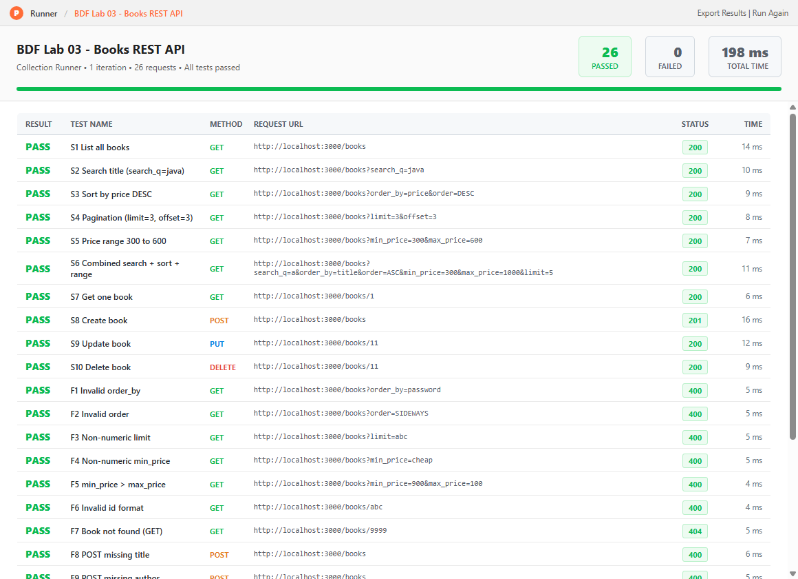

# Lab 3: REST API, Query Parameters, Validation, Debugging

## Student Details

- **Name:** OM SAI CHARAN MANCHANI
- **Registration Number:** 252U1R9090
- **Section:** CSE-GEN-AI 2B 111
- **Course:** Backend Development Fundamentals
- **Lab Number:** 03

## Live Link

**Deployment URL:** https://YOUR-DEPLOYMENT-URL

(If the project cannot be deployed, write the reason here and rely on the Postman screenshots below.)

## Objective

To turn the Lab 2 bookstore routes into a clean REST API with search, sorting, pagination, a price filter, input validation, correct HTTP status codes, a consistent JSON response format, and to practise fixing common errors.

## Technologies Used

- Node.js
- Express.js
- SQLite (`sqlite` and `sqlite3` packages)
- Postman

## Project Structure

```
lab-03/
├── screenshots/
├── index.js                  # Express server and routes
├── queryBuilder.js           # query parameter checks, SQL building, body validation
├── setupDb.js                # creates bookstore.db from initDB.sql
├── initDB.sql                # table definition and sample data
├── test_routes.js            # quick script that checks every route and status code
├── postman_collection.json   # Postman tests (success and failure cases)
├── package.json
├── .gitignore
└── README.md
```

## Installation and Setup

### Prerequisites

- Node.js 18 or newer, and npm

### Environment variables

| Variable | Required | Default | Purpose           |
| -------- | -------- | ------- | ----------------- |
| `PORT`   | No       | `3000`  | Port for the server |

No secrets are used. A `.env` file is not needed and must never be committed.

### Steps to Run

```
cd lab-03
npm install
npm run setup     # creates bookstore.db with sample books
npm start         # starts the server on http://localhost:3000
```

To check all routes automatically (server must be running in another terminal):

```
npm run test:routes
```

To import the Postman tests: Postman, Import, choose `postman_collection.json`.

## Endpoints

Endpoints are nouns (`/books`) and the HTTP method shows the action.

| Method | Path           | Description                                          | Success |
| ------ | -------------- | ---------------------------------------------------- | ------- |
| GET    | `/books`       | List books with search, sort, pagination and filters | 200     |
| GET    | `/books/:id`   | Get one book by id                                   | 200     |
| POST   | `/books`       | Create a book                                        | 201     |
| PUT    | `/books/:id`   | Update a book                                        | 200     |
| DELETE | `/books/:id`   | Delete a book                                        | 200     |

### Query parameters for `GET /books`

| Parameter   | Default | Description                                                    |
| ----------- | ------- | -------------------------------------------------------------- |
| `search_q`  | empty   | Partial title match using `LIKE`                               |
| `order_by`  | `id`    | One of `id`, `title`, `author`, `price`                        |
| `order`     | `ASC`   | `ASC` or `DESC`                                                |
| `limit`     | `10`    | Whole number from 1 to 100                                     |
| `offset`    | `0`     | Whole number, 0 or more                                        |
| `min_price` | none    | Lowest price (uses `BETWEEN` when `max_price` is also given)   |
| `max_price` | none    | Highest price                                                  |

Example: `GET /books?search_q=java&order_by=price&order=DESC&limit=5&min_price=200&max_price=800`

### Validation rules for POST and PUT

- `title` is required and must be a non-empty string
- `author` is required and must be a non-empty string
- `price` is required, must be numeric, and cannot be negative
- Anything else returns `400` with a JSON message

### Response format

Errors always use the same shape:

```json
{ "message": "price is required and must be a number" }
```

Successful list response:

```json
{ "total": 10, "count": 3, "limit": 3, "offset": 0, "books": [ { "id": 1, "title": "...", "author": "...", "price": 450 } ] }
```

## HTTP Status Codes

| Code | Used when                                                              |
| ---- | ---------------------------------------------------------------------- |
| 200  | Successful read, update or delete                                      |
| 201  | Book created                                                           |
| 400  | Bad input: invalid query parameter, invalid id, bad body, broken JSON  |
| 404  | Book id does not exist, or the route does not exist                    |
| 500  | Unexpected server error                                                |

## Postman Test List

Import `postman_collection.json`. Each request has a test that checks the expected status code.

### Success cases

| #   | Request                                                            | Expected |
| --- | ------------------------------------------------------------------ | -------- |
| S1  | `GET /books`                                                       | 200      |
| S2  | `GET /books?search_q=java`                                         | 200      |
| S3  | `GET /books?order_by=price&order=DESC`                             | 200      |
| S4  | `GET /books?limit=3&offset=3`                                      | 200      |
| S5  | `GET /books?min_price=300&max_price=600`                           | 200      |
| S6  | Combined search, sort and price range                              | 200      |
| S7  | `GET /books/1`                                                     | 200      |
| S8  | `POST /books` with valid body                                      | 201      |
| S9  | `PUT /books/:id` with valid body                                   | 200      |
| S10 | `DELETE /books/:id`                                                | 200      |

### Failure cases

| #   | Request                                                 | Expected |
| --- | ------------------------------------------------------- | -------- |
| F1  | `GET /books?order_by=password`                          | 400      |
| F2  | `GET /books?order=SIDEWAYS`                             | 400      |
| F3  | `GET /books?limit=abc`                                  | 400      |
| F4  | `GET /books?min_price=cheap`                            | 400      |
| F5  | `GET /books?min_price=900&max_price=100`                | 400      |
| F6  | `GET /books/abc`                                        | 400      |
| F7  | `GET /books/9999`                                       | 404      |
| F8  | `POST /books` without title                             | 400      |
| F9  | `POST /books` without author                            | 400      |
| F10 | `POST /books` with `"price": "abc"`                     | 400      |
| F11 | `POST /books` with negative price                       | 400      |
| F12 | `POST /books` with broken JSON                          | 400      |
| F13 | `PUT /books/1` with empty title                         | 400      |
| F14 | `PUT /books/9999`                                       | 404      |
| F15 | `DELETE /books/9999`                                    | 404      |
| F16 | `GET /authors` (unknown route)                          | 404      |

For S9 and S10, change the id in the URL to the id returned by S8.

## Screenshots

Add each screenshot to the `screenshots/` folder with the file names below.

### 1. Search by title


### 2. Sorting


### 3. Pagination


### 4. Price range filter


### 5. Create book (201)


### 6. Update and delete (200)


### 7. Validation error (400)


### 8. Book not found (404)


### 9. Postman test results


## Debugging Exercise

The faculty gives a broken version of the project. These are the four errors and how to fix them.

| Error                                  | What it looks like                                          | Fix                                                                                                   |
| -------------------------------------- | ----------------------------------------------------------- | ----------------------------------------------------------------------------------------------------- |
| Port conflict (`EADDRINUSE`)           | `Error: listen EADDRINUSE: address already in use :::3000`  | Stop the other process on port 3000 (Ctrl + C in the old terminal) or run with another `PORT`.        |
| Wrong import path                      | `Error: Cannot find module './queryBuilders'`               | Match the real file name and path exactly, e.g. `require("./queryBuilder")`.                          |
| Table name typo                        | `SQLITE_ERROR: no such table: book`                         | Use the real table name from `initDB.sql`: `books`.                                                   |
| Missing `await`                        | The response shows `{}` or a Promise instead of data        | Add `await` before `db.all`, `db.get` and `db.run`, and keep the route function `async`.              |

## Viva Questions

### 1. Query parameter vs path parameter?

A path parameter identifies one specific resource and is part of the URL path, like `/books/5`. A query parameter comes after `?` and adjusts the result, such as search, sort, filter or pagination, like `/books?order_by=price`.

### 2. What does stateless mean?

Each request contains everything the server needs to handle it. The server does not remember earlier requests from the same client.

### 3. Which status code for bad input vs a missing record?

Bad input returns `400 Bad Request`. A record that does not exist returns `404 Not Found`.

## Notes: Problems Faced and Solutions

Write the real problems you faced here and how you solved them.

- `order_by` and `order` cannot be `?` placeholders, so they are checked against a fixed list before being placed in the query. All other user input goes through `?` placeholders.
- (Add your own problems here.)

## Git and Repository Notes

- `.gitignore` excludes `node_modules/` and `.env`.
- `bookstore.db` is created by `npm run setup`.
- Screenshots are stored in the `screenshots/` folder.
- This lab is submitted in the `lab-03/` folder of the course repository.
